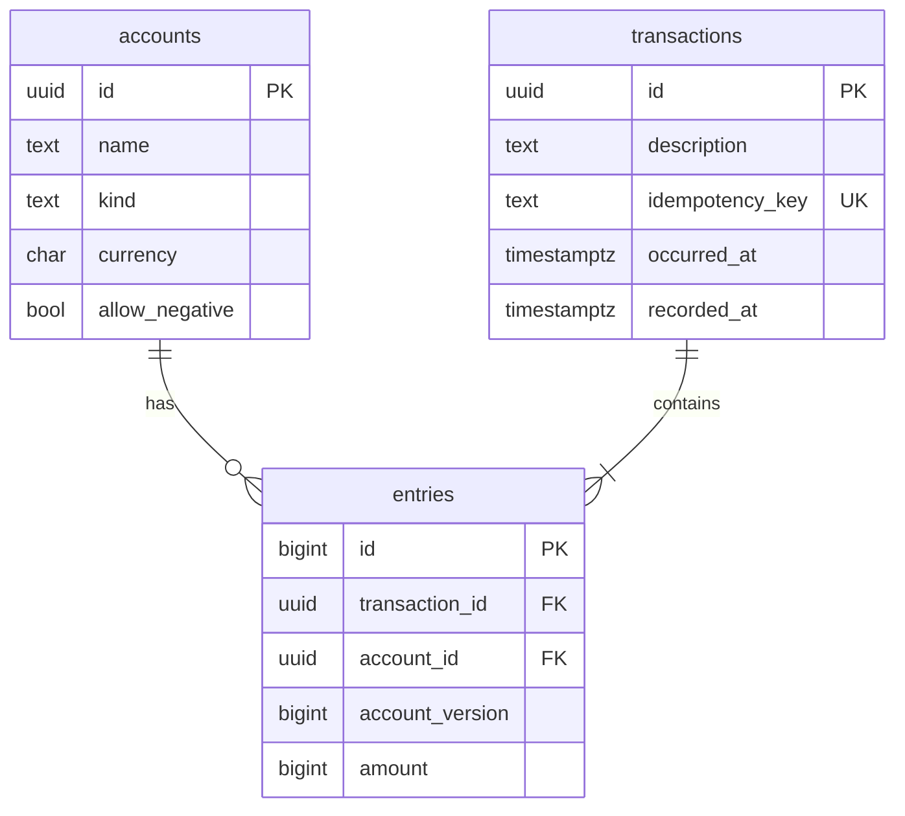

# Event-Sourced Ledger

A double-entry bank core where money is modeled as an **immutable stream of events**,
not as a mutable balance column.

## Core idea
- Every balance change is an append-only entry. Nothing is ever updated or deleted.
- Every transaction has entries that sum to zero (double-entry bookkeeping).
- Balances are always derived from history, so any past moment can be reconstructed and explained.

## Tech stack
Python 3.12 · FastAPI · PostgreSQL 16 · psycopg 3 · Docker Compose · pytest · GitHub Actions

## Project status
| Phase | Description | Status |
|---|---|---|
| 0 | Project setup, health endpoint, Postgres, CI | Done |
| 1 | Domain model (Money, Entry, Transaction) | Done |
| 2 | Database schema, migrations, append-only enforcement | Done |
| 3 | Posting transactions atomically (repository + service) | Done |
| 4 | Derived balances and overdraft rule | Done |
| 5 | REST API | Done |
| 6 | Point-in-time queries | Done |
| 7 | Audit trail | Done |
| 8 | Concurrency | Planned |
| 9 | Idempotency and hardening | Planned |

## Architecture
```
api/           FastAPI routes, request/response schemas, error mapping (thin: no business rules)
domain/        pure Python rules: Money, Entry, Transaction, Account, audit replay, errors
services/      business flow; owns the database transaction (unit of work)
repositories/  SQL only, no business decisions
db/            connection and migration runner
migrations/    numbered SQL files
```

## API
Interactive docs (Swagger UI): `http://127.0.0.1:8000/docs`

All amounts are **integers in minor units** (paise/cents): `2500` means Rs 25.00.
Floats and numeric strings are rejected. Every money request states its `currency` explicitly.

| Method | Path | Description | Success |
|---|---|---|---|
| GET | /health | Liveness check | 200 |
| POST | /accounts | Create a customer account | 201 |
| GET | /accounts/{id} | Read an account | 200 |
| GET | /accounts/{id}/balance | Current balance, or a historical one with `as_of` / `known_at` | 200 |
| GET | /accounts/{id}/audit | Replayed history with running balances and integrity checks (paged) | 200 |
| POST | /accounts/{id}/deposits | Deposit money (from the outside world) | 201 |
| POST | /accounts/{id}/withdrawals | Withdraw money (to the outside world) | 201 |
| POST | /transfers | Transfer between two customer accounts | 201 |

Deposits, withdrawals and transfers accept an optional `occurred_at` (see Point-in-time queries).

Example:
```bash
curl -s -X POST http://127.0.0.1:8000/accounts \
  -H "Content-Type: application/json" \
  -d '{"name": "Asha", "currency": "INR"}'

curl -s -X POST http://127.0.0.1:8000/accounts/<ACCOUNT_ID>/deposits \
  -H "Content-Type: application/json" \
  -d '{"amount": 10000, "currency": "INR", "occurred_at": "2026-11-03T10:00:00Z"}'

curl -s "http://127.0.0.1:8000/accounts/<ACCOUNT_ID>/balance?as_of=2026-11-04T00:00:00Z"
curl -s "http://127.0.0.1:8000/accounts/<ACCOUNT_ID>/audit?limit=20"
```

### Errors
Business errors return `{"error": {"code": "...", "message": "..."}}`.

| Status | `code` | Meaning |
|---|---|---|
| 404 | `account_not_found` | Unknown account |
| 403 | `system_account_not_allowed` | SYSTEM accounts (e.g. EXTERNAL) cannot be used through the public API |
| 409 | `insufficient_funds` | Would overdraw a normal account |
| 409 | `duplicate_transaction` | Transaction id already posted |
| 409 | `concurrent_modification` | Another writer changed the same account; safe to retry |
| 422 | `currency_mismatch` | Request currency differs from the account currency |
| 422 | `occurred_at_in_future` | `occurred_at` is later than now |
| 422 | `invalid_money`, `invalid_transaction`, `unbalanced_transaction` | Request breaks a domain rule |
| 422 | (FastAPI format) | Malformed body or parameter, including datetimes without a timezone |

**422** means the request itself is wrong; **409** means the request is fine but conflicts with the current state.

> **Known limitation:** the API has **no authentication or authorization**. It is a learning
> project; a real bank API would need identity and permission checks.

## Domain model
| Type | Meaning |
|---|---|
| `Money` | Exact integer amount in minor units (paise/cents) plus currency. Floats are rejected. |
| `Entry` | One immutable ledger line: an account and a signed `Money`. |
| `Transaction` | A group of entries that must obey the invariants below. |
| `Account` | Who can hold money. `EXTERNAL` is the SYSTEM account for the outside world. |

**Sign convention:** a positive entry moves money *into* an account, a negative entry moves money *out*.

**Transaction invariants** (checked at construction):
1. At least 2 entries
2. All entries share one currency (multi-currency planned for Phase 11)
3. Entries sum to exactly zero
4. `occurred_at` is timezone-aware
5. Entry amounts are never zero

## Database



**Rules enforced by the database itself (defence in depth):**
- `entries` and `transactions` reject `UPDATE`, `DELETE` and `TRUNCATE` (triggers).
- Entries of a transaction must sum to zero, checked **at COMMIT** (deferred constraint trigger).
- A transaction must have at least 2 entries (deferred constraint trigger).
- Entry amounts are never zero; accounts and transactions must exist.

### Migrations
Plain SQL files in `migrations/`, applied in filename order and recorded in `schema_migrations`.
**Never edit an applied migration; add a new one.**
```bash
python -m app.db.migrate
```

## Balances and overdraft
There is no balance column. An account's balance is **derived** by replaying its entries
(`SUM(amount)`). The ledger as a whole always sums to zero, which `get_ledger_total` can verify.

**Overdraft rule:** an account with `allow_negative = false` can never end a transaction
below zero. SYSTEM accounts such as `EXTERNAL` may go negative.

The service reads an account's **balance and last version in one SQL statement**, so they
come from the same snapshot. If two writers race on one account, both try to append the same
`account_version`; the `UNIQUE (account_id, account_version)` constraint rejects one of them
with `ConcurrentModificationError`, so a stale balance can never cause an overdraft.
(Locking and retries come in Phase 8.)

## Point-in-time queries
Because history is kept as events, any past balance is just a sum over a filtered set of entries.
Each transaction carries two times:

| Time | Column | Meaning |
|---|---|---|
| valid time | `occurred_at` | When it happened in the real world. May be backdated. |
| system time | `recorded_at` | When the ledger saved it. Set by the database. |

`GET /accounts/{id}/balance` accepts:
- `as_of`: count only entries that **occurred** by this moment (inclusive). "What was the balance on Tuesday, as far as we know today?"
- `known_at`: additionally count only entries the ledger had **recorded** by this moment. "What did our books say on Tuesday?"

Datetimes must include a timezone (use `Z` or `%2B` for `+` in URLs).

Rules and trade-offs:
- Transactions may be **backdated but never future-dated**, so "balance as of now" always equals the current balance.
- **Known limitation:** the overdraft rule checks the balance **now**. A backdated withdrawal can make a *past* balance negative if today's balance can cover it. This is pinned down by a test.
- The query is a join plus `SUM` over the account's history; snapshots (Phase 10) will address performance.

## Audit trail
`GET /accounts/{id}/audit?after_version=0&limit=50` replays the account's entries in
`account_version` order (the order they were recorded) and explains how it reached its balance.

Each line contains: the entry amount, the **running balance** after it, the counterparty
accounts, `occurred_at`, `recorded_at` and a readable `explanation`
(e.g. `Sent 300 to Rahul (rent)`).

The response also has a `summary` (entry count, total credits, total debits, opening and closing balance)
and an `integrity` block with independent checks:

| Check | Meaning |
|---|---|
| `balance_matches` | Replayed closing balance equals the balance from a separate `SUM` query |
| `versions_contiguous` | Versions are exactly 1, 2, 3, ... (no missing or duplicated event) |
| `unbalanced_transactions` | Transactions touching this account that do not sum to zero (must be 0) |
| `ok` | All of the above pass |

Design notes:
- The replay is **pure domain code** (`domain/audit.py`) and is unit tested without a database.
- All queries run in one read-only **REPEATABLE READ** transaction, so they see a single snapshot and a concurrent deposit cannot cause a false mismatch.
- Summary and integrity cover the **full** history; only `lines` are paged, so running balances stay correct on every page. `next_after_version` is `null` on the last page.
- The whole history is replayed per request; snapshots (Phase 10) will reduce that cost.

## How a transaction is posted
`services/ledger_service.post_transaction(conn, tx)`:
1. Reject future-dated transactions
2. Open a database transaction (`BEGIN`)
3. Check every account exists and its currency matches the entry
4. Per account: read balance + last version (one statement) and apply the overdraft rule
5. Insert the `transactions` row, then each entry with the next `account_version`
6. `COMMIT`, where the database re-checks the balance rule

Any failure rolls everything back, so there are no partial transfers.
Service code needs an **autocommit** connection (`app.db.connection.connect`) so that
`conn.transaction()` is a real `BEGIN`/`COMMIT` and deferred triggers fire inside the service.
The API opens one such connection per request (`app/api/dependencies.py`).

## Design decisions
- **Integer minor units** instead of floats, to avoid rounding errors (also strict in the API).
- **Immutable objects** (frozen dataclasses), matching the append-only model.
- **Layered architecture**: api / services / repositories / domain.
- **Thin API layer**: routes translate HTTP to service calls; business rules live below.
- **Central error mapping**: domain errors become stable HTTP status + `code` pairs.
- **SYSTEM accounts are not reachable from the public API**, otherwise money could be minted.
- **Raw SQL with psycopg** (no ORM), so transactions and locking stay visible.
- **Rules at two levels**: Python domain objects and database triggers.
- **Derived balances**: computed from history, never stored as the source of truth.
- **Two time axes** (`occurred_at`, `recorded_at`) so we can answer both "what was true" and "what did we know".
- **Independent verification**: the audit re-derives the balance and cross-checks it, even though the database should make mismatches impossible.
- **Per-account version numbers** with a UNIQUE constraint as a safety net against concurrent writers.

## Getting started
```bash
python -m venv .venv
source .venv/Scripts/activate      # Git Bash on Windows
pip install -r requirements.txt
docker compose up -d               # PostgreSQL, host port 5433 -> container 5432
docker compose exec db psql -U ledger -d ledger -c "CREATE DATABASE ledger_test;"   # once
python -m app.db.migrate           # create the tables
uvicorn app.main:app --reload      # run the API, then open /docs
pytest                             # run tests (needs PostgreSQL running)
```

## Git workflow
- One branch per phase: `phase-N/short-name`
- Conventional commit messages (`feat:`, `test:`, `docs:`, `chore:`, `ci:`)
- PRs are merged with a **merge commit** so every commit stays in the history