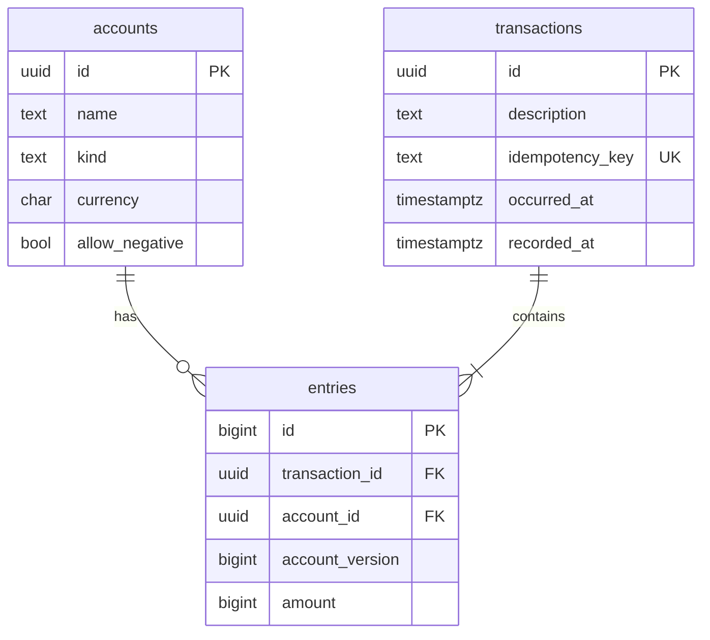

# Event-Sourced Ledger

A double-entry bank core where money is modeled as an **immutable stream of events**,
not as a mutable balance column.

## Core idea
- Every balance change is an append-only entry. Nothing is ever updated or deleted.
- Every transaction has entries that sum to zero (double-entry bookkeeping).
- Balances are always derived from history.

## Tech stack
Python 3.12 · FastAPI · PostgreSQL 16 · psycopg 3 · Docker Compose · pytest · GitHub Actions

## Project status
| Phase | Description | Status |
|---|---|---|
| 0 | Project setup, health endpoint, Postgres, CI | Done |
| 1 | Domain model (Money, Entry, Transaction) | Done |
| 2 | Database schema, migrations, append-only enforcement | Done |
| 3 | Posting transactions atomically (repository + service) | Done |
| 4 | Derived balances and overdraft rule | Done |
| 5 | REST API | Planned |
| 6 | Point-in-time queries | Planned |
| 7 | Audit trail | Planned |
| 8 | Concurrency | Planned |
| 9 | Idempotency and hardening | Planned |

## Architecture
```
domain/        pure Python rules: Money, Entry, Transaction, Account, errors
repositories/  SQL only, no business decisions
services/      business flow; owns the database transaction (unit of work)
db/            connection and migration runner
migrations/    numbered SQL files
```

## Domain model
| Type | Meaning |
|---|---|
| `Money` | Exact integer amount in minor units (paise/cents) plus currency. Floats are rejected. |
| `Entry` | One immutable ledger line: an account and a signed `Money`. |
| `Transaction` | A group of entries that must obey the invariants below. |
| `Account` | Who can hold money. `EXTERNAL` is the SYSTEM account for the outside world. |

**Sign convention:** a positive entry moves money *into* an account, a negative entry moves money *out*.

**Transaction invariants** (checked at construction):
1. At least 2 entries
2. All entries share one currency (multi-currency planned for Phase 11)
3. Entries sum to exactly zero
4. `occurred_at` is timezone-aware
5. Entry amounts are never zero

## Database



**Rules enforced by the database itself (defence in depth):**
- `entries` and `transactions` reject `UPDATE`, `DELETE` and `TRUNCATE` (triggers).
- Entries of a transaction must sum to zero, checked **at COMMIT** (deferred constraint trigger).
- A transaction must have at least 2 entries (deferred constraint trigger).
- Entry amounts are never zero; accounts and transactions must exist.

### Migrations
Plain SQL files in `migrations/`, applied in filename order and recorded in `schema_migrations`.
**Never edit an applied migration; add a new one.**
```bash
python -m app.db.migrate
```

## Balances and overdraft
There is no balance column. An account's balance is **derived** by replaying its entries
(`SUM(amount)`). The ledger as a whole always sums to zero, which `get_ledger_total` can verify.

**Overdraft rule:** an account with `allow_negative = false` can never end a transaction
below zero. SYSTEM accounts such as `EXTERNAL` may go negative.

The service reads an account's **balance and last version in one SQL statement**, so they
come from the same snapshot. If two writers race on one account, both try to append the same
`account_version`; the `UNIQUE (account_id, account_version)` constraint rejects one of them
with `ConcurrentModificationError`, so a stale balance can never cause an overdraft.
(Locking and retries come in Phase 8.)

## How a transaction is posted
`services/ledger_service.post_transaction(conn, tx)`:
1. Open a database transaction (`BEGIN`)
2. Check every account exists and its currency matches the entry
3. Per account: read balance + last version (one statement) and apply the overdraft rule
4. Insert the `transactions` row, then each entry with the next `account_version`
5. `COMMIT`, where the database re-checks the balance rule

Any failure rolls everything back, so there are no partial transfers.

| Situation | Error |
|---|---|
| Unknown account | `AccountNotFoundError` |
| Entry currency differs from account | `CurrencyMismatchError` |
| Would overdraw a normal account | `InsufficientFundsError` |
| Same transaction id posted twice | `DuplicateTransactionError` |
| Two writers appended to one account at once | `ConcurrentModificationError` |

Service code needs an **autocommit** connection (`app.db.connection.connect`) so that
`conn.transaction()` is a real `BEGIN`/`COMMIT` and deferred triggers fire inside the service.

```python
from app.db.connection import connect
from app.domain.money import Money
from app.repositories.accounts import create_account
from app.services.ledger_service import deposit, withdraw, transfer, get_balance

conn = connect()
asha = create_account(conn, "Asha")
rahul = create_account(conn, "Rahul")
deposit(conn, asha.id, Money(10_000))            # Rs 100.00 in paise
transfer(conn, asha.id, rahul.id, Money(2_500))
withdraw(conn, rahul.id, Money(1_000))
print(get_balance(conn, asha.id))                # Money(amount=7500, currency='INR')
```

## Design decisions
- **Integer minor units** instead of floats, to avoid rounding errors.
- **Immutable objects** (frozen dataclasses), matching the append-only model.
- **Layered architecture**: domain / repositories / services / API.
- **Raw SQL with psycopg** (no ORM), so transactions and locking stay visible.
- **Rules at two levels**: Python domain objects and database triggers.
- **Derived balances**: computed from history, never stored as the source of truth.
- **Per-account version numbers** with a UNIQUE constraint as a safety net against concurrent writers.

## Getting started
```bash
python -m venv .venv
source .venv/Scripts/activate      # Git Bash on Windows
pip install -r requirements.txt
docker compose up -d               # PostgreSQL, host port 5433 -> container 5432
docker compose exec db psql -U ledger -d ledger -c "CREATE DATABASE ledger_test;"   # once
python -m app.db.migrate           # create the tables
uvicorn app.main:app --reload      # run the API
pytest                             # run tests (needs PostgreSQL running)
```

## Endpoints
| Method | Path | Description |
|---|---|---|
| GET | /health | Liveness check |

## Git workflow
- One branch per phase: `phase-N/short-name`
- Conventional commit messages (`feat:`, `test:`, `docs:`, `chore:`, `ci:`)
- PRs are merged with a **merge commit** so every commit stays in the history